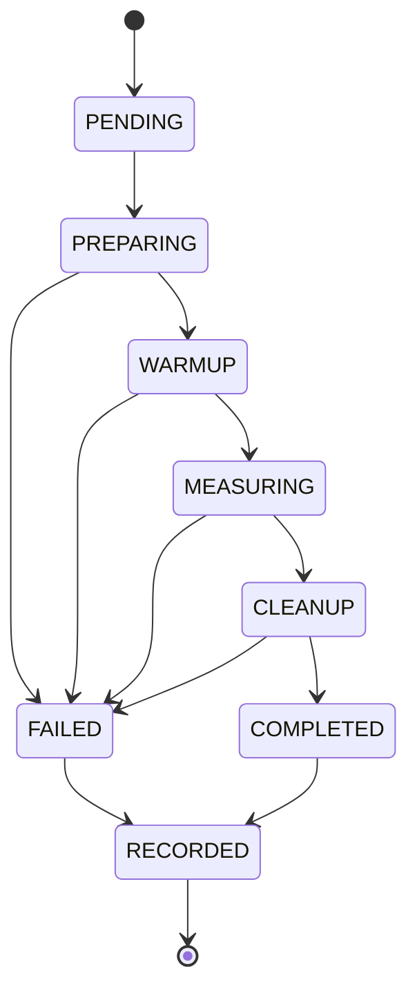

# V-TRACE — Final High-Level Design (HLD)

**Version:** 1.0 | **Status:** Implementation specification | **Primary development host:** Ubuntu in WSL2 on AMD Ryzen 5 5600H (6 cores / 12 threads; WSL sees 7.4 GiB RAM, 2 GiB swap) | **Owner:** Research team

> **Agent instruction:** Build the system described here together with `V-TRACE_Final_Project_Scope.md`. Treat **MVP / mandatory** requirements as implementation commitments. Do not fabricate experimental results. Every unsupported host capability must yield an explicit *skipped / unsupported* state, never a silently substituted measurement.

## 1. Problem and contribution

V-TRACE is a **Go-based, reproducible performance-experiment framework**, not a hypervisor, scheduler, or optimization service. It measures CPU-, memory-, disk-, and network-intensive workloads, injects controlled resource interference, collects Linux and application metrics, and statistically attributes **observed outcome variation to manipulated experimental factors** (execution mode, workload, interference, resource constraints, and interactions).

This is based on the supplied V-TRACE proposal. The additional explicit execution-stack comparisons (native Linux, KVM, Docker-in-KVM and Azure nested KVM) are **planned research extensions**, not capabilities that WSL2 alone can establish.

### Research questions

- **RQ1:** Within the WSL2 development testbed, how does controlled resource interference change time, throughput and run-to-run variability for each of four workload classes?
- **RQ2:** Within each workload, what amount of variation in the measured response is associated with assigned execution mode, interference, selected resource settings, and their interactions, with uncertainty?
- **RQ3 (validation extension):** Do major effects reproduce on **native Linux on the same physical laptop**, comparing native processes, Docker, KVM guests and Docker-in-KVM?
- **RQ4 (optional cloud replication):** Do selected patterns replicate inside a non-burstable Azure Linux VM, comparing execution in the Azure guest against execution in an additional nested KVM guest? This measures **incremental nested virtualization**, not the Azure host hypervisor overhead.

### Claims and limits

1. **WSL2 + Docker Desktop is a development/initial empirical environment.** A WSL native process and a Docker Desktop container can use different Linux guest contexts. Record this boundary and do **not** call their difference isolated container overhead.
2. **A single Azure VM is not bare metal.** Direct Azure guest vs nested KVM measures added nested-guest effects, not total hypervisor overhead.
3. **Bare-metal Ubuntu vs KVM on the same physical laptop** is the best planned local comparison for *incremental KVM virtualization*; matching CPU affinity, RAM, kernel, disk and thermal state is still required.
4. ANOVA effect sizes characterize **variance associated with controlled factors in a specific experimental design**. Host counters are explanatory covariates, not automatic evidence of per-layer causation. Results must not be described as percentages of the physical virtualization stack.
5. No raw comparison of absolute latency across workloads with different work units. Conduct primary tests within each workload; normalized slowdown is permitted for cross-workload aggregation.

## 2. Supported execution backends

| Backend identifier | Workload location | Planned status | Interpretation |
|---|---|---|---|
| `wsl-process` | User's Ubuntu WSL distro | **MVP** | Native Linux process *within WSL2* |
| `docker-desktop` | Docker Desktop Linux engine | **MVP** | Container under Docker Desktop; engine context fingerprint required |
| `linux-process` | Bare-metal Ubuntu on same Ryzen | **Phase 2** | Bare-metal Linux reference |
| `linux-docker` | Docker Engine on same bare-metal Ubuntu | **Phase 2** | Container vs process on same kernel/host |
| `kvm-process` | Ubuntu guest under local KVM | **Phase 2** | Added KVM guest relative to host |
| `kvm-docker` | Docker inside local KVM | **Phase 2** | Container inside virtual machine |
| `azure-process` / `azure-docker` | Azure non-burstable Linux VM | **Phase 3** | Virtualized Azure guest reference |
| `azure-nested-process` / `azure-nested-docker` | Nested KVM guest on Azure VM | **Phase 3, if supported** | Added nested KVM stack |

**Do not implement fake KVM support on WSL2.** Backend capabilities must be probed. Azure sizes, nested virtualization flags and availability must be verified at deployment time.

## 3. System boundaries and data flow

```mermaid
flowchart LR
    R[Researcher / CLI] --> C[Go controller]
    C --> D[Host doctor & capability registry]
    C --> P[Manifest validation & randomized planner]
    P --> E[Trial state machine]
    E --> B[Execution backend interface]
    B --> NP[Local process]
    B --> DE[Docker Engine]
    B -. Phase 2/3 .-> VM[Remote / KVM adapters]
    E --> I[Interference orchestration]
    E --> M[Metrics sampler]
    M --> PR[/proc & /sys]
    M --> CG[cgroup v2]
    M --> DS[Docker stats/inspect]
    E --> W[Atomic JSONL writer]
    W --> A[Raw trial dataset]
    A --> S[Summary & QC validator]
    S --> PY[Python stats + plots]
    PY --> O[Research tables, figures, report]
```

```
Development laptop (Windows)
  └─ Microsoft hypervisor / WSL2 Ubuntu distro
      ├─ vtrace Go controller, process adapter, metadata, Python analysis
      └─ Docker CLI → Docker Desktop Linux engine (separately fingerprinted)

Later, native Linux boot on same Ryzen laptop
  ├─ Native process | native Docker Engine
  └─ QEMU/KVM guest → guest process | guest Docker

Optional Azure non-burstable VM
  ├─ Linux process | Docker Engine
  └─ KVM guest if /dev/kvm and acceleration work → process | Docker
```

**Storage boundary:** project files and the default disk workload reside under `/home/<user>/vtrace`, never `/mnt/c` unless testing Windows-backed filesystem access is an explicitly named factor. Avoid repeatedly placing stress files on the Windows drive.

## 4. Component ownership and interfaces

### 4.1 Go CLI (`cmd/vtrace`)

Commands:

```text
vtrace doctor [--json] [--output PATH]
vtrace plan --config experiments/pilot.yaml [--output PATH]
vtrace run --config experiments/pilot.yaml [--resume RUN_ID] [--dry-run]
vtrace status --run RUN_ID
vtrace summarize --run RUN_ID
vtrace export --run RUN_ID --format csv|jsonl
vtrace cleanup --run RUN_ID [--force]
```

Commands must have non-zero exit codes for configuration errors or invalid runs; summary must state partial failures. No service/database/UI is required in the MVP.

### 4.2 Capability/host profiler (`internal/host`)

Capture immutable **per-run** `host.json`: timestamp UTC; CPU model, cores, SMT siblings, logical CPU mapping and affinity; Linux distribution, kernel, virtualization detection; cgroup filesystem version/controllers; available RAM/swap; filesystem and mount type; Docker context, engine version, engine OS/kernel/CPU/memory, `docker info`, container runtime, and whether container engine lives outside the calling distro; Go/tool versions; hostname anonymized via a stable run-local identifier; power/thermal info where readable. Record *unavailable* instead of filling null values with zero. Store git commit, manifest hash and benchmark image digests.

`doctor` reports backend capability separately: `available | unavailable | uncertain`; checks Docker daemon reachability, write permissions, cgroup v2, benchmark executables, `/dev/kvm` for KVM-capable hosts, and storage free space.

### 4.3 Planner (`internal/experiment`)

Parse versioned YAML, validate factor combinations, generate unique `condition_id` from canonical serialized factors, randomize trial execution **in reproducible blocks** using an explicit seed, serialize complete `plan.jsonl` **before any trial**, then execute in order. Factor values and units are immutable for a run; reject unknown keys where practical. Ensure exact repetitions per condition, including when resuming. Disallow mixing trial-level results from different execution environments into a single factorial model without an explicit environment factor and appropriate blocking.

### 4.4 Workload adapters (`internal/workload`)

Implement a common interface:

```go
type Workload interface {
    Name() string
    Prepare(ctx context.Context, s TrialSpec) error
    Execute(ctx context.Context, s TrialSpec, emit SampleSink) (WorkloadResult, error)
    Cleanup(ctx context.Context, s TrialSpec) error
}
```

Supported classes:

- **CPU:** `sysbench cpu` with fixed time or fixed work units; record operations/events per second, events, actual duration; fixed task parameters.
- **Memory:** `sysbench memory` (or deterministic Go allocator/bandwidth benchmark), fixed transfer count/size and effective throughput; avoid swapping by default.
- **Disk:** `fio` with fixed job file, size, depth, block size, direct I/O setting, fsync policy and file location; capture IOPS, MiB/s, job duration, tail latencies when provided. Separate host filesystem and container volume treatments; do not silently compare different underlying devices/filesystems.
- **Network:** `iperf3` with a separately started, fixed endpoint (same local/VM topology where possible); collect throughput, retransmits, transport, connection path. For network conclusions, document any NAT/virtual NIC differences; do not call local loopback measurements physical network performance.

Use maintained benchmark binaries packaged consistently; same benchmark version, configuration and work units across eligible modes. Runtime workload images pinned by digest for confirmatory campaigns. Parse structured outputs when supported; preserve raw logs.

### 4.5 Execution backends (`internal/executor`)

```go
type Executor interface {
    ID() string
    Probe(ctx context.Context) Capability
    Start(ctx context.Context, spec ExecSpec) (Handle, error)
    Wait(ctx context.Context, h Handle) (ExitResult, error)
    Stop(ctx context.Context, h Handle) error
    Inspect(ctx context.Context, h Handle) (ResourceIdentity, error)
}
```

- Local process adapter uses `os/exec` with process groups, timeouts, safe termination and optional `taskset`/affinity.
- Docker adapter uses Docker Engine API or well-formed `docker` command invocations; pin CPUs/memory, collect container ID and inspect data; never assume container host `/proc` equals WSL's `/proc`.
- Phase 2 remote/VM adapters use SSH with explicit auth and equivalent stdout/stderr/result contract; are **not** silently simulated in WSL.
- Do not add `--privileged`, root host mounts or security weakening by default. Provision only benchmark-specific mounts and least privileges needed.

### 4.6 Controlled interference (`internal/interference`)

Types: `none`, `cpu`, `memory`, `disk`, `network`. Intensity parameter is explicit (`low`, `high`, or numeric resource targets). Interference process/container has its **own** logs, resources and lifecycle. Start, verify readiness, allow stabilization period, run target, stop via context cancellation, verify cleanup. For the 160-trial pilot, use *workload-matched interference* (CPU with CPU, memory with memory, etc.) and name the actual interference type in every record; this is a screening design, not a single physically identical interference treatment. Any cross-workload statistical model must treat these as distinct conditions.

### 4.7 Sampler (`internal/metrics`)

Sample at configurable interval (default 250 ms; lower rates optional after overhead validation) and capture: monotonic-relative time, CPU usage delta, CPU throttling if available, memory/current/max and OOM events, disk read/write counters, network byte/packet counters when meaningfully visible, PSI (`/proc/pressure/*`) on applicable host/guest, and benchmark-reported outcomes. Use `cgroup v2` counters from the correct target context, or Docker stats/inspect for Docker Desktop; include `source` and `scope` for every metric. Sampling failure must be represented as `missing` plus reason, never fabricated as zero. Measure sampler-on vs sampler-off overhead in calibration.

### 4.8 Durable run storage (`internal/storage`)

File-backed MVP; write append-only JSONL with atomic flush/rename as appropriate and stable schemas. One run directory:

```text
runs/<run_id>/
  manifest.yaml              # snapshot of requested experiment
  host.json                  # immutable environment fingerprint
  plan.jsonl                 # exact ordered trials
  events.jsonl               # state transitions, faults, cleanup
  trials.jsonl               # one record / attempted trial
  samples.jsonl              # time-series metrics, linked by trial_id
  logs/<trial_id>.stdout.log
  logs/<trial_id>.stderr.log
  exports/trials.csv
  analysis/quality_report.json
  analysis/summary.csv
  analysis/figures/*.png
  analysis/statistical_report.md
```

Implement single-writer or locking to prevent corruption. Flush completed trial records; on restart, resume only missing or explicitly failed trials according to a manifest policy; never duplicate a `trial_id`. `run_id` combines UTC timestamp and config hash, not personally identifying data.

### 4.9 Analysis (`analysis/` Python virtual environment)

Use pandas/numpy/scipy/statsmodels/matplotlib (versions locked). The Go CLI may invoke Python but experiment execution must not depend on Python analysis being installed. Outputs: descriptive statistics (mean, median, SD, CoV, p95, p99, bootstrap confidence intervals), per-condition validity counts, relative slowdown with CIs, and **within-workload factorial analysis** (execution mode × interference; optionally resources) with effect sizes (partial eta squared or equivalent, clearly defined). Check residuals, heteroscedasticity, non-normality; consider log response, robust/permutation analysis or hierarchical models for session effects. Treat trial or session as experimental unit, not individual sampler points. Explain interactions and uncertainty. FDR adjustment for planned multiple outcomes where appropriate. Never auto-write conclusions that data do not support.

## 5. Trial state machine and reliability



Always use `defer`-style cleanup. All external commands need timeouts and captured exit statuses. Log `failed`, `timed_out`, `invalid`, `skipped_unsupported`, and `completed` distinctly. A trial does **not** become valid merely because a subprocess exited 0: require parseable benchmark output, workload completeness, elapsed duration and necessary resource identity. A failed container cleanup is a run-level warning and blocks the next trial until resolved.

## 6. Manifest contract (starter)

```yaml
schema_version: 1
name: wsl_pilot
seed: 20261013
repetitions: 10
blocks: 10
backends: [wsl-process, docker-desktop]
workloads: [cpu, memory, disk, network]
interference: [none, matched]
resources:
  target_cpus: 2
  target_memory_mb: 1024
  interference_cpus: 2
  interference_memory_mb: 512
trial:
  warmup_seconds: 5
  measure_seconds: 30
  cooldown_seconds: 5
  timeout_seconds: 90
sampling:
  interval_ms: 250
output:
  root: runs
```

The planner translates `matched` into an explicit interference workload per target class and records it. The schema must support workload-specific parameters (e.g., fio path, iperf server endpoint) and fail validation when omitted. In WSL2, target CPU and memory constraints may have different enforcement mechanisms between local processes and Docker Desktop. `doctor` must document whether equivalence can be established and, if not, mark comparisons **environment-confounded**.

## 7. Data model (minimum)

**Trial record**: `schema_version`, `run_id`, `trial_id`, `condition_id`, `block_id`, `order`, `attempt`, `host_id`, `backend`, `workload`, `interference_kind`, `interference_intensity`, `workload_params`, `resource_limits`, `warmup_s`, `duration_s`, `status`, `valid`, `invalid_reason`, `start_utc`, `end_utc`, `elapsed_ms`, `work_units`, `throughput`, `throughput_unit`, `latency_p95_ms` (nullable and only if valid per-op samples exist), `latency_p99_ms` (nullable), `exit_code`, `log_paths`, `container_id` (nullable), `metrics_scope`, `environment_confounded`.

**Metric sample**: `run_id`, `trial_id`, `relative_ms`, `source`, `scope`, `metric`, `value`, `unit`, `available`, `missing_reason`. Preserve raw counters and compute rates only where valid deltas and monotonic times exist.

**Data quality rules:** UTC for wall timestamps and monotonic time for elapsed measurement; explicit units; `null` for missing; schema versions; trial uniqueness; target/interference separation; checksums or hashes of manifests and workload artifacts; never overwrite original raw evidence with analysis outputs.

## 8. Research experiment design

### MVP pilot — 160 scheduled trials

`4 workload classes × 2 WSL2 execution modes × 2 interference levels × 10 independent repetitions = 160`. Randomized block order (each block includes all 16 conditions). Fixed workload sizes and matched timeouts. Primary output specified separately for each workload before running; retain secondary outcomes and complete records. For network, run `iperf3` endpoint in a documented topology and do not claim external-network effects. For disk, preallocate or warm disk in a documented, consistent way and distinguish cold/warm cache effects.

### Confirmatory WSL2 campaign

Use valid findings from pilot to select 1–2 primary outcomes per workload. Target ≥30 independent runs per selected condition, spread across multiple sessions, with session/block modeled in analysis; do not promise power absent a pilot-based estimate. Add interference levels and specific resource caps only as independently randomized factors. Monitor host thermal and CPU variability where available; do not interpret Windows host counters that the Linux guest cannot observe as if measured.

### Phase 2 native Linux/KVM validation

Direct Ubuntu install/boot on **same Ryzen device**, then native process, Docker (native engine), KVM guest, and Docker-in-KVM. Confirm hardware acceleration with `/dev/kvm` and KVM verification. Prefer same Linux release and kernel family in host/guest where feasible; reserve host resources; pin vCPUs and memory; document virtio storage/network; compare host and guest separately within workload class. No change to stored schema or analytical pipeline.

### Phase 3 optional Azure replication

Non-burstable VM, verified nested virtualization, fixed VM SKU/region/image and recorded actual CPU model, kernel, deployment identity. Direct Azure guest vs nested KVM guest; optional Docker in each. This isolates **incremental nested stack difference** only. Run shorter replication of selected contrasts, not an indiscriminate full matrix.

## 9. Repository layout

```text
vtrace/
  README.md
  docs/HLD.md
  docs/PROJECT_SCOPE.md
  cmd/vtrace/main.go
  internal/config/
  internal/host/
  internal/experiment/
  internal/executor/{process,docker,remote}/
  internal/workload/
  internal/interference/
  internal/metrics/
  internal/storage/
  internal/quality/
  experiments/pilot.yaml
  experiments/confirmatory.example.yaml
  benchmarks/{cpu,memory,disk,network}/
  docker/benchmark.Dockerfile
  analysis/{requirements.txt,analyze.py,tests/}
  scripts/{bootstrap-wsl.sh,smoke.sh,validate.sh}
  tests/{fixtures,integration}/
  runs/.gitkeep
  .gitignore
  go.mod
```

Agent may reorganize files modestly while preserving public CLI, output and manifest contracts. Keep `runs/`, secrets and large datasets out of Git.

## 10. Security, ethics, and reproducibility

- The entire project is intended for **owned test environments only**. No stress tests against arbitrary external hosts or unauthorized networks.
- Docker benchmark images use non-root users where practical, read-only mounts except scratch, memory/PID limits, and no host networking unless explicitly justified for a named network condition.
- `iperf3` listens locally/private addresses only by default; protect Azure NSG/SSH if cloud extensions are enabled.
- No secrets in YAML, logs or research exports. Use environment variables/SSH agent for remote access.
- Check disk free space and memory before each trial; stop if storage, pressure or thermal guardrails are breached. Never disable host security features or change Windows virtualization settings without explicit human action.
- Record tool versions, CPU topology, manifest/seed, image digests, raw outputs, trial failures, and quality exclusions. Missing or invalid results are reported, not silently removed.

## 11. Definition of done and non-goals

**MVP done** only when `doctor`, `plan`, `run`, `status`, `summarize`, `export`, `cleanup` work; four benchmark classes run locally and in Docker where feasible; interference is verified and cleaned up; all 160 pilot conditions are schedulable; real runs persist valid, versioned results; statistical analysis produces honest summaries/CIs/factor models where sample size permits; a smoke suite passes on the specified WSL2 host; and WSL/Docker environment confounding is clearly recorded.

**Explicit non-goals:** building a hypervisor; kernel patching; a Kubernetes cluster; distributed scheduler; production web app/dashboard; unqualified physical-layer causality claims; guaranteeing publication acceptance; manufacturing missing data; requiring Azure to complete the WSL2 MVP.
